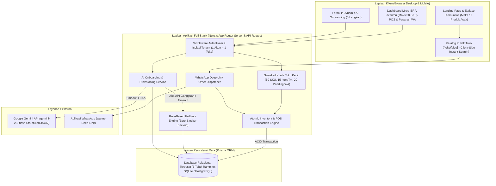
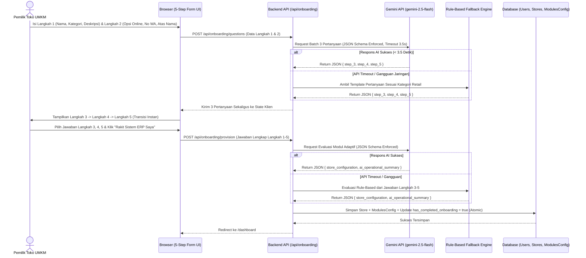
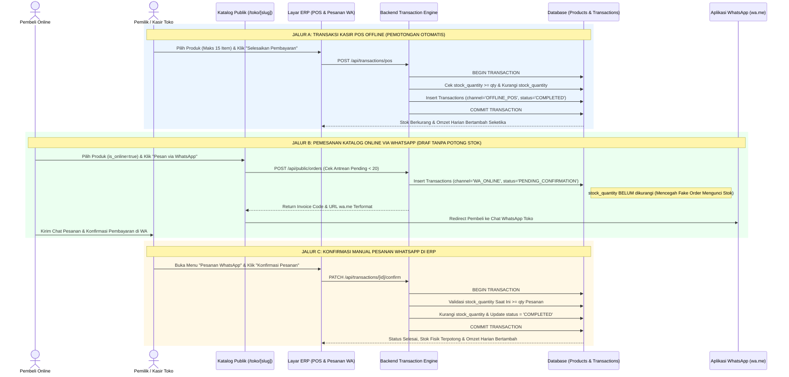
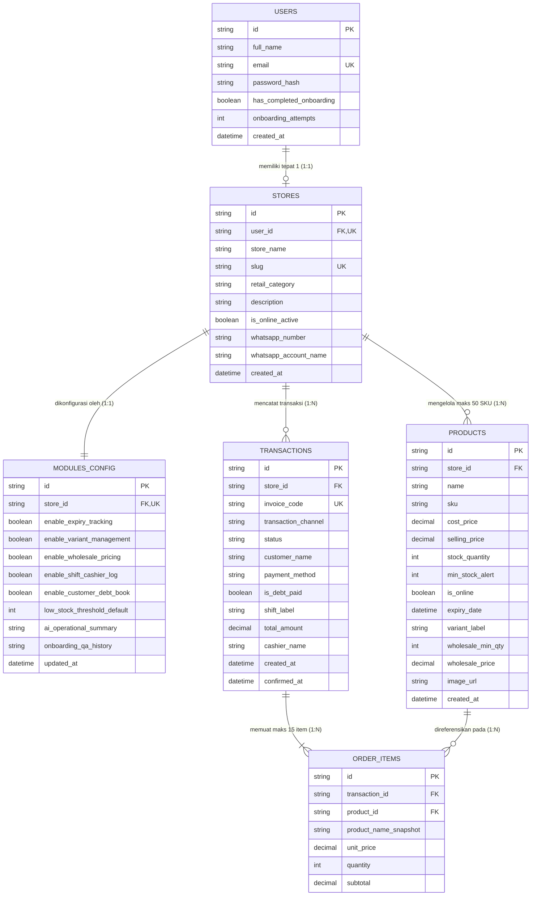

# DOKUMEN PERANCANGAN ARSITEKTUR WEBSITE
## Warungin — Adaptive Micro-ERP & WhatsApp Commerce Platform

| Informasi Dokumen | Detail Spesifikasi |
| --- | --- |
| **Nama Produk** | Warungin |
| **Kompetisi** | National AI Summit & Competition (NAISC) 2026 — Kategori Website |
| **Sub-Tema / Fokus** | Akselerasi Inovasi Kecerdasan Buatan untuk Efisiensi Operasional UMKM Retail |
| **Arsitektur Aplikasi** | Monolithic Full-Stack Web Application (Next.js App Router + TypeScript) |
| **Basis Data & ORM** | Relational Database (SQLite untuk Lokal/Demo & PostgreSQL/Turso untuk Cloud) via Prisma ORM |
| **Mesin Kecerdasan Buatan** | Google Gemini API (`gemini-2.5-flash` dengan *Structured JSON Output* & *Rule-Based Fallback*) |
| **Versi Dokumen** | v1.1 (Siap Ekspor PDF — Kelengkapan Penjurian NAISC 2026) |

---

## BAB 1: TINJAUAN ARSITEKTUR SISTEM (HIGH-LEVEL ARCHITECTURE)

### 1.1 Filosofi Perancangan: *Adaptive Micro-ERP with Zero Daily Bloat*

**Warungin** dirancang khusus untuk menjawab permasalahan toko retail skala kecil di Indonesia (warung sembako, toko bahan kue, butik pakaian kecil, apotek mini, dan kios perlengkapan harian). Berbeda dengan sistem ERP konvensional yang membebani perangkat pengguna dengan puluhan menu rumit, Warungin menerapkan arsitektur **Micro-ERP Berbasis Provisioning AI**:

1. **AI Hanya Bekerja Saat Perakitan Awal (*Onboarding Provisioning*)**: Model bahasa besar (*Large Language Model* / LLM) dipanggil tepat **2 kali** saat pemilik toko mendaftarkan usahanya melalui formulir 5 langkah untuk merakit konfigurasi modul (`ModulesConfig`).
2. **Operasional Harian Tanpa Latensi AI (*Zero Daily AI Overhead*)**: Setelah dashboard terbentuk, seluruh aktivitas harian (Kasir POS, Inventori, Katalog Publik, dan Konfirmasi Pesanan WhatsApp) berjalan 100% di atas transaksi basis data relasional terindeks dengan waktu respons milidetik.
3. **Satu Basis Data Tunggal (*Single Source of Truth*)**: Stok barang di meja kasir offline dan katalog online `/toko/[slug]` terhubung pada satu tabel produk yang sama dengan mekanisme pemotongan stok atomik.

### 1.2 Diagram Arsitektur Sistem Tingkat Tinggi



### 1.3 Komponen Utama Arsitektur

| Lapisan Arsitektur | Teknologi yang Digunakan | Tanggung Jawab Teknis |
| --- | --- | --- |
| **Presentation Layer (Frontend)** | Next.js App Router (React 19), TypeScript, Tailwind CSS, Lucide Icons | Merender *Standardized Clean UI Template*, menjalankan filter produk instan di sisi klien (*client-side search*), dan mengelola keranjang kasir/katalog secara responsif. |
| **Application & Security Layer** | Next.js Route Handlers / Server Actions, JWT Session Cookie, Middleware | Memvalidasi sesi pengguna, menerapkan isolasi *multi-tenant* (`store_id`), serta menegakkan aturan kuota toko kecil sebelum menyentuh basis data. |
| **AI Provisioning Layer** | Google GenAI SDK (`@google/genai`), Model `gemini-2.5-flash` | Menghasilkan 3 pertanyaan diagnostik kontekstual (Langkah 3–5) dan menerjemahkan jawaban pengguna menjadi skema boolean `ModulesConfig`. Dilengkapi *Rule-Based Fallback* otomatis. |
| **Data Persistence Layer** | Prisma ORM + SQLite (Lokal/Demo) / PostgreSQL (Cloud Production) | Menyimpan 6 tabel relasional utama dan menjamin integritas pemotongan stok melalui transaksi atomik (`prisma.$transaction`). |

---

## BAB 2: PEMBATASAN BEBAN SISTEM & KUOTA TOKO KECIL (MICRO-RETAIL LOAD CONTROL)

Untuk memastikan aplikasi berjalan sangat ringan di ponsel pintar berspesifikasi rendah maupun laptop kasir toko kecil, arsitektur Warungin menerapkan **7 Guardrail Pembatasan Beban** secara ketat di level aplikasi dan basis data:

| No. | Parameter Pembatasan | Batas Kuota Sistem | Implementasi Teknis pada Arsitektur |
| --- | --- | --- | --- |
| **1.** | **Rasio Akun & Toko** | **1 Akun = 1 Toko** | Kolom `user_id` pada tabel `stores` memiliki constraint `UNIQUE`. Menghilangkan kompleksitas *multi-branch switching* pada setiap request. |
| **2.** | **Kapasitas Inventori (SKU)** | **Maks. 50 Produk per Toko** | API penambahan produk memeriksa `COUNT(id) WHERE store_id = ? < 50`. Dengan batas 50 produk, seluruh daftar produk toko dapat dimuat sekaligus (< 15 KB JSON) dan dicari secara instan di memori browser tanpa *query* berulang. |
| **3.** | **Ukuran Media Produk** | **Maks. 1 Foto (<= 500 KB)** | Mendukung pemilihan ikon/ilustrasi kategori bawaan yang ringan atau URL gambar terkompresi agar waktu muat katalog `/toko/[slug]` di jaringan 4G tetap **< 1,5 detik**. |
| **4.** | **Kapasitas Keranjang Belanja** | **Maks. 15 Jenis Barang / Transaksi** | Validasi array `items.length <= 15` pada endpoint POS dan WhatsApp Dispatcher sehingga eksekusi *loop* pemotongan stok atomik selesai dalam < 20 milidetik. |
| **5.** | **Antrean Pesanan WhatsApp** | **Maks. 20 Pesanan `PENDING_CONFIRMATION`** | Mencegah *flooding* pesanan fiktif dari publik; jika antrean mencapai 20 pesanan belum dikonfirmasi, sistem meminta toko memvalidasi/membatalkan antrean lama terlebih dahulu. |
| **6.** | **Jendela Data Dashboard** | **Maks. 20 Transaksi Terbaru & Metrik Harian** | Query tabel transaksi menggunakan `ORDER BY created_at DESC LIMIT 20`, dan kartu metrik inti hanya menghitung transaksi pada hari berjalan. |
| **7.** | **Batas Panggilan AI** | **2 Panggilan API saat Setup (Maks. 2x Re-Onboarding)** | Kolom `onboarding_attempts <= 2` pada tabel `users`. Menghilangkan beban biaya token dan latensi AI pada operasional harian. |

---

## BAB 3: DESAIN ALUR INTERAKSI & SEQUENCE DIAGRAM

### 3.1 Sequence Diagram: Dynamic AI Onboarding (5 Langkah) & Mekanisme Fallback

Diagram berikut menjelaskan bagaimana sistem menggabungkan pembuatan pertanyaan Langkah 3, 4, dan 5 ke dalam **1 kali panggilan batch API** agar perpindahan antar langkah di layar pengguna berlangsung instan tanpa *loading* berulang.



### 3.2 Sequence Diagram: Dual-Channel Commerce & Sinkronisasi Stok Fisik

Diagram ini memperlihatkan perbedaan krusial antara **Jalur Kasir POS Offline** (pemotongan stok otomatis saat bayar) dan **Jalur Katalog WhatsApp** (pencatatan draf `PENDING_CONFIRMATION` tanpa memotong stok hingga dikonfirmasi manual oleh pemilik/kasir).



---

## BAB 4: PERANCANGAN BASIS DATA & ENTITY RELATIONSHIP DIAGRAM (ERD)

### 4.1 Diagram Relasi Entitas (ERD 6 Tabel Ramping)

Seluruh kebutuhan operasional inti maupun ke-5 modul adaptif AI ditampung secara efisien ke dalam **6 tabel relasional** tanpa tabel tambahan yang membebani *join query*.



### 4.2 Strategi Indeksasi & Optimasi Query Database

Agar setiap halaman dimuat dalam hitungan milidetik, indeks berikut diterapkan pada skema basis data:
1. **`stores(slug)` (`UNIQUE INDEX`)**: Memastikan pencarian halaman katalog publik `/toko/[slug]` berjalan dengan kompleksitas `O(1)` tanpa memindai tabel.
2. **`products(store_id, is_online)` (`COMPOSITE INDEX`)**: Mempercepat pengambilan daftar produk katalog publik maupun Etalase Komunitas.
3. **`transactions(store_id, status, created_at)` (`COMPOSITE INDEX`)**: Mempercepat agregasi omzet harian, pemuatan 20 transaksi terbaru, dan pengecekan kuota 20 pesanan `PENDING_CONFIRMATION`.

---

## BAB 5: SPESIFIKASI INTEGRASI AI & MEKANISME FALLBACK

### 5.1 Kontrak JSON Panggilan AI #1 (Question Generator)

* **Endpoint Internal**: `POST /api/onboarding/questions`
* **Model**: `gemini-2.5-flash` dengan `responseMimeType: "application/json"`
* **Batas Waktu (Timeout)**: `3500 ms` (3,5 detik)
* **Struktur Output Baku**:

```json
{
  "step_3": {
    "question": "Bagaimana karakteristik utama barang dagangan yang Anda kelola di toko?",
    "options": [
      "Barang konsumsi/makanan yang memiliki tanggal kedaluwarsa",
      "Produk pakaian/kerajinan dengan variasi ukuran atau warna",
      "Barang harian yang dijual eceran sekaligus grosir (beli banyak lebih murah)"
    ]
  },
  "step_4": {
    "question": "Bagaimana pola penjagaan kasir dan pembayaran pelanggan di toko Anda?",
    "options": [
      "Dijaga sendiri secara penuh dan hanya menerima pembayaran tunai/QRIS lunas",
      "Dijaga bergantian shift (pagi/sore) bersama anggota keluarga atau staf",
      "Sering melayani pelanggan tetap yang mencatat kasbon (bayar tempo)"
    ]
  },
  "step_5": {
    "question": "Pada sisa stok berapa Anda ingin sistem memberikan peringatan stok menipis?",
    "options": [
      "Saat sisa stok mencapai 5 unit (toko perputaran barang sedang)",
      "Saat sisa stok mencapai 10 unit (toko sembako/perputaran cepat)",
      "Saat sisa stok mencapai 3 unit (produk eksklusif/butik)"
    ]
  }
}
```

### 5.2 Kontrak JSON Panggilan AI #2 (Module Provisioning Engine)

* **Endpoint Internal**: `POST /api/onboarding/provision`
* **Struktur Output Baku**:

```json
{
  "store_configuration": {
    "enable_expiry_tracking": true,
    "enable_variant_management": false,
    "enable_wholesale_pricing": true,
    "enable_shift_cashier_log": true,
    "enable_customer_debt_book": false,
    "low_stock_threshold_default": 10
  },
  "ai_operational_summary": "Berdasarkan profil toko sembako Anda, sistem telah mengaktifkan Modul Peringatan Kedaluwarsa, Harga Grosir 1-Lapis, dan Rekap Shift Kasir dengan batas peringatan stok 10 unit."
}
```

### 5.3 Matriks *Rule-Based Fallback Engine* (Ketahanan Sistem 100%)

Apabila kunci API belum dikonfigurasi pada lingkungan penguji atau terjadi gangguan jaringan ke server LLM eksternal, modul `fallback-engine.ts` secara otomatis mengambil alih tanpa menampilkan pesan *error* kepada pengguna:

| Kategori Retail Pengguna | Modul Default yang Diaktifkan oleh Fallback Engine | Ambang Stok Default |
| --- | --- | --- |
| **Toko Kelontong / Sembako** | `ExpiryTracker` + `WholesaleTier` + `DebtLedger` | `10` unit |
| **Kuliner / Bahan Kue / Apotek Mini** | `ExpiryTracker` + `ShiftHandover` | `8` unit |
| **Fesyen / Butik / Toko Pakaian** | `VariantMatrix` + `WholesaleTier` | `3` unit |
| **Toko Perlengkapan / Alat Tulis / Lainnya** | `WholesaleTier` + `ShiftHandover` | `5` unit |

---

## BAB 6: ARSITEKTUR ANTARMUKA & MODULAR CARD ENGINE

### 6.1 Pemetaan Komponen UI terhadap Konfigurasi AI

Antarmuka Dashboard ERP menggunakan struktur *Grid Layout* yang tetap dan tidak pernah berubah secara acak. Variasi antar toko dikendalikan murni melalui pembacaan objek `modules_config`:

| Nama Komponen UI | Sifat Visibilitas | Sumber Data & Perilaku Ringan |
| --- | --- | --- |
| `Card_Core_Omzet` | **Selalu Tampil** | Menghitung `SUM(total_amount)` dari transaksi `COMPLETED` hari ini beserta jumlah nota. |
| `Card_Core_TopProducts` | **Selalu Tampil** | Menampilkan 5 produk dengan kuantitas terjual tertinggi hari ini/minggu ini. |
| `Card_Core_LowStock` | **Selalu Tampil** | Menampilkan daftar produk yang memiliki `stock_quantity <= min_stock_alert`. |
| `Card_Core_CashierLog` | **Selalu Tampil** | Menampilkan tabel 20 transaksi terbaru (`OFFLINE_POS` & `WA_ONLINE` yang telah dikonfirmasi). |
| `Card_Mod_ExpiryTracker` | `enable_expiry_tracking == true` | Menampilkan maks. 5 produk dengan `expiry_date` dalam <= 14 hari ke depan & membuka input tanggal kedaluwarsa di form Inventori. |
| `Card_Mod_VariantMatrix` | `enable_variant_management == true` | Menampilkan ringkasan stok berdasarkan tag `variant_label` & membuka input label varian di form Inventori. |
| `Card_Mod_WholesaleTier` | `enable_wholesale_pricing == true` | Menampilkan daftar produk bergrosir & menerapkan diskon harga grosir otomatis di keranjang POS saat `qty >= wholesale_min_qty`. |
| `Card_Mod_ShiftHandover` | `enable_shift_cashier_log == true` | Menampilkan perbandingan omzet `Shift Pagi` vs `Shift Sore` hari ini & mengaktifkan pemilih shift di layar POS. |
| `Card_Mod_DebtLedger` | `enable_customer_debt_book == true` | Menampilkan daftar nota `KASBON` (`is_debt_paid = false`) lengkap dengan tombol 1-klik **"Tandai Lunas"**. |

---

## BAB 7: KEAMANAN, INTEGRITAS TRANSAKSI, & DEPLOYMENT

1. **Isolasi Multi-Tenant Berbasis Sesi (`Session-Bound Store Guard`)**:
   Setiap *API Route* di bawah `/api/erp/*` mengambil `userId` dan `storeId` langsung dari token sesi terenkripsi (`HttpOnly Cookie`), bukan dari parameter URL atau *body request*, sehingga mustahil bagi satu toko untuk memanipulasi data toko lain.
2. **Pencegahan *Race Condition* Stok (`ACID Transaction`)**:
   Saat kasir menekan tombol bayar di POS atau mengonfirmasi pesanan WhatsApp, pengecekan ketersediaan stok (`stock_quantity >= requested_qty`) dan pengurangan stok dieksekusi di dalam satu blok transaksi database atomik. Jika salah satu barang tidak mencukupi, seluruh transaksi dibatalkan (*rollback*).
3. **Kesiapan Penjurian & Akun Demo Instan**:
   Sistem dilengkapi *database seeder* otomatis yang menyediakan **3 Toko Sampel Berbeda Kategori** (Toko Sembako Berkah Jaya, Butik Busana Nusantara, dan Toko Bahan Kue Manis) beserta fitur **1-Klik Login Demo Akun Instan** di halaman Login dan Landing Page agar Dewan Juri NAISC 2026 dapat menguji seluruh fitur dalam hitungan detik.

